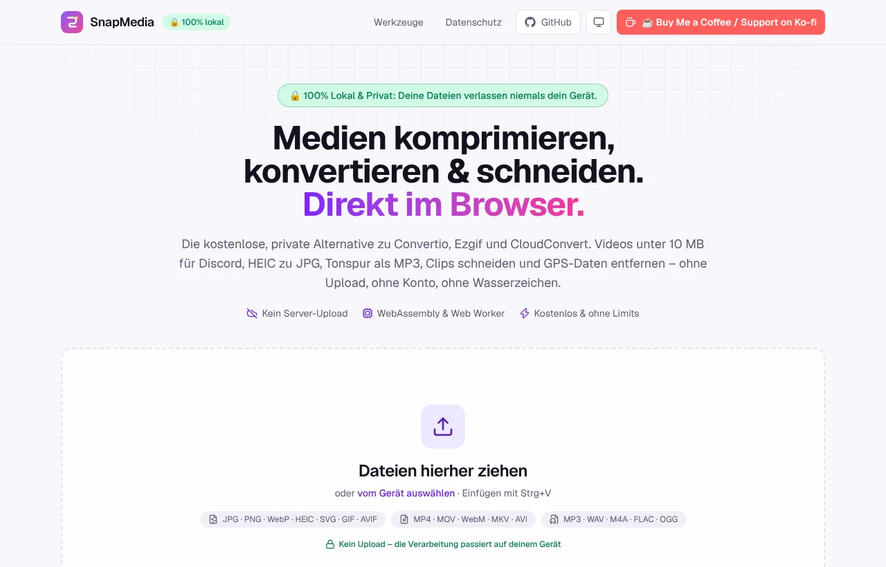
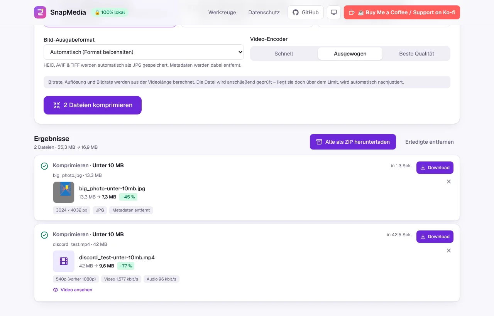
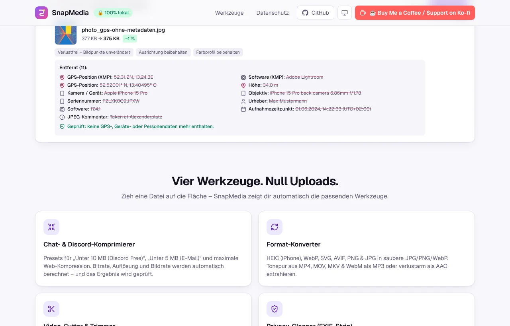
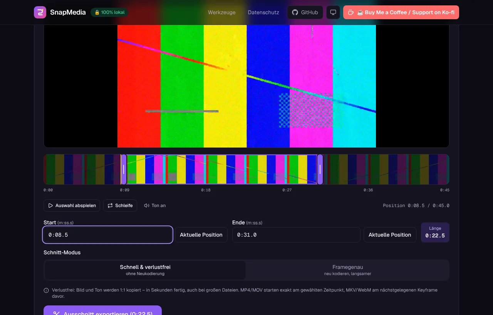
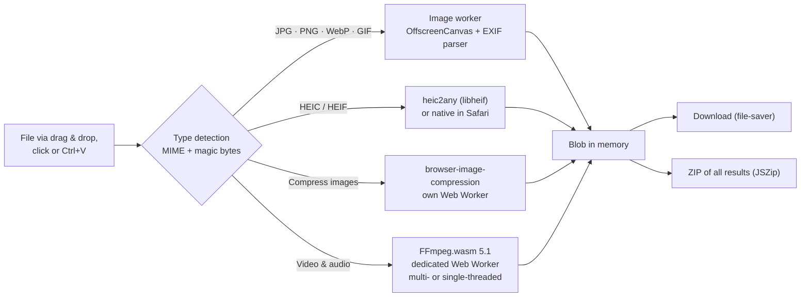

<div align="center">


# SnapMedia

**Compress, convert and trim videos & images and strip GPS data – 100% locally in your browser.**

The free, private alternative to Convertio, Ezgif and CloudConvert.<br />
No upload. No account. No watermark. No queue.

[](LICENSE)
[](https://nextjs.org)
[](https://www.typescriptlang.org)
[](https://github.com/ffmpegwasm/ffmpeg.wasm)
[](#-privacy-compared)
[](#-languages-english--german)
[](https://ko-fi.com/cind3rbyte)

English · **[Deutsch](README.de.md)**

[Features](#-features) · [Privacy](#-privacy-compared) · [Quick start](#-quick-start) · [Deploy to Vercel](#-deploy-to-vercel) · [How it works](#-how-it-works) · [Support](#-support-the-project)

<br />



</div>

> **🔒 100% Local & Private: Your files never leave your device.**
> FFmpeg, libheif and the image pipeline run as WebAssembly inside Web Workers in your browser.
> A Content Security Policy (`connect-src 'self'`) technically forbids the app from talking to any other server –
> even if a library tried, the browser would block the request.

---

## ✨ Features

Drop any media file onto the drop zone – SnapMedia detects the file type (MIME type **and** magic bytes, so HEIC, MKV & co. are recognized even without a proper MIME type) and shows only the tools that fit.

| Tool | What it does | Formats |
| --- | --- | --- |
| 🗜️ **Chat & Discord compressor** | Presets **“Under 10 MB (Discord Free)”**, **“Under 5 MB (Email / upload limits)”** and **“Maximum web compression”**. Bitrate, resolution and frame rate are calculated from the video length; the finished file is checked and automatically re-encoded if it is still too large. Animated GIFs stay animated. | Video: MP4, MOV, WebM, MKV, AVI → MP4 (H.264/AAC) · Images: JPG, PNG, WebP, HEIC, AVIF, GIF · Audio: MP3, WAV, FLAC, M4A, OGG → AAC |
| 🔄 **Format converter** | Images instantly to clean JPG, PNG or WebP (metadata removed), SVG at 1×/2×/4×, transparency with a background color of your choice. Audio track from videos as MP3 (128–320 kbit/s) or **losslessly as AAC** (the original track is copied 1:1 when it already is AAC). Plus: MOV/MKV → MP4, video → GIF, GIF → MP4. | HEIC, HEIF, WebP, SVG, PNG, JPG, AVIF, BMP, TIFF, GIF · MP4, MOV, MKV, WebM, AVI, MP3, WAV, FLAC, OGG |
| ✂️ **Video cutter & trimmer** | Visual timeline with thumbnails (or a waveform for audio), two draggable handles, a movable selection, keyboard control (←/→ = 0.1 s, Shift = 1 s) and time input to a tenth of a second. Export **losslessly in seconds** (MP4/MOV start exactly at the chosen point thanks to an edit list) or **frame-accurately** re-encoded. | MP4, MOV, MKV, WebM, AVI, HEVC/H.265, MP3, M4A, WAV, FLAC, OGG |
| 🛡️ **Privacy cleaner (EXIF strip)** | Removes GPS coordinates, camera & phone model, serial numbers, lens, capture time, software, author, XMP/IPTC and comments. Shows what was found beforehand and verifies the result. JPG, PNG, WebP and GIF are cleaned **losslessly** (bit-identical pixels, orientation and color profile preserved). Videos (e.g. iPhone location) & audio without re-encoding. | JPG, PNG, WebP, GIF, HEIC, AVIF, TIFF · MP4, MOV, MKV, WebM, MP3, M4A … |

**Also included:** an interface in **English and German** – detected automatically and switchable at any time with the EN/DE toggle in the header, without losing files or running jobs. Drag & drop anywhere on the page and paste with <kbd>Ctrl</kbd>+<kbd>V</kbd>, batch processing, live progress bars with percentages, cancelling running jobs, result previews, **bulk download as ZIP**, dark/light mode and a layout that works on phones.

<table>
  <tr>
    <td></td>
    <td></td>
  </tr>
  <tr>
    <td align="center"><sub>42 MB video (1080p, 45 s) → 9.6 MB for Discord</sub></td>
    <td align="center"><sub>Privacy cleaner: 11 entries removed, pixels untouched</sub></td>
  </tr>
</table>

<div align="center">
  
  <br /><sub>Video cutter with a thumbnail timeline (dark mode)</sub>
</div>

## 🔐 Privacy compared

Classic online converters upload your files to their servers. With private photos and videos – faces, license plates and the GPS coordinates of your home – that is a real risk.

| | **SnapMedia** | CloudConvert | Convertio |
| --- | :---: | :---: | :---: |
| Where is the processing done? | **In your browser** (WebAssembly) | On their servers | On their servers |
| Files leave your device | **Never** | Yes (upload) | Yes (upload) |
| Technically enforced (CSP `connect-src 'self'`) | **Yes** | – | – |
| Account / subscription for larger volumes | **Not needed** | For more quota | For larger files |
| Limits | **Only your device** (RAM/CPU) | Daily quota on the free plan | File & daily limits on the free plan |
| Queue under load | **None** | Possible | Possible |
| Keeps working without internet once the page has loaded | **Yes** | No | No |
| Auditable source code | **Yes, MIT** | No | No |
| Cost | **€0** | Free quota, then paid | Free with limits, then subscription |

<sub>Third-party information: general way of working as of November 2026, without guarantee – their current pricing and privacy pages are authoritative.</sub>

**Check it yourself:** open your developer tools → Network tab and process a file. Apart from SnapMedia's own program files (e.g. the FFmpeg engine under `/ffmpeg/`) there is not a single request – let alone an upload.

## ⚡ Quick start

Requirement: **Node.js ≥ 18.18** (recommended: 20 LTS or newer).

```bash
git clone https://github.com/cind3rbyte/SnapMedia.git snapmedia
```

```bash
cd snapmedia
```

```bash
npm install
```

```bash
npm run dev
```

Then open [http://localhost:3000](http://localhost:3000) – done. 🎉 (German directly: [http://localhost:3000/de](http://localhost:3000/de))

`npm install` automatically copies the WebAssembly engines from `node_modules` to `public/ffmpeg/` and `public/vendor/` via `postinstall` – they are self-hosted, never loaded from a CDN.

More commands:

| Command | Purpose |
| --- | --- |
| `npm run build` | Production build (including type check & lint) |
| `npm start` | Start the production server |
| `npm run lint` | ESLint (Next.js Core Web Vitals + TypeScript) |
| `npm run typecheck` | TypeScript check in strict mode |

## ▲ Deploy to Vercel

SnapMedia is a standard Next.js project and needs **zero configuration**:

[](https://vercel.com/new/clone?repository-url=https%3A%2F%2Fgithub.com%2Fcind3rbyte%2FSnapMedia&project-name=snapmedia&repository-name=snapmedia)

1. Import the repository at [vercel.com/new](https://vercel.com/new) (or use the button above).
2. The framework is detected as **Next.js** automatically → **Deploy**.

The required headers (`Cross-Origin-Opener-Policy: same-origin`, `Cross-Origin-Embedder-Policy: require-corp`, Content Security Policy and more) are set in `next.config.js` – on Vercel exactly as locally. This makes `SharedArrayBuffer` available, so FFmpeg runs in the fast **multi-threaded mode**. On Vercel the language detection additionally uses the visitor's country (see below).

> **Other hosts** (Netlify, your own server, Docker …) work as well with `npm run build && npm start`. If a host does not send the COOP/COEP headers, SnapMedia automatically falls back to the single-threaded engine – slower, but fully functional.

## 🌍 Languages: English & German

- **English** is the default (`/en`), **German** lives at `/de` – both pages are statically pre-rendered (including `hreflang` links).
- Visiting `/` serves the right language automatically (`src/middleware.ts`):
  1. a saved choice from the EN/DE toggle (cookie `NEXT_LOCALE`),
  2. the browser language (`de-DE`, `de-AT`, `de-CH` … → German),
  3. on Vercel also the request's country (header `x-vercel-ip-country`): visitors from Germany, Austria, Switzerland, Liechtenstein or Luxembourg get German as long as their browser accepts German at all,
  4. otherwise English.
- No external service is contacted for this. All texts live in `src/i18n/dictionaries/` (`en.ts` is the reference, `de.ts` is checked for completeness by TypeScript) – adding another language means adding one dictionary file.

## 🧠 How it works



### Discord / email compression: reliably under the limit

1. **Analysis** with `ffprobe` (JSON): duration, resolution, frame rate, rotation, codecs, bitrates.
2. **Budget:** `target size × 0.95 − container overhead` → total bitrate = budget × 8 ÷ duration.
3. **Split:** audio gets 128/96/64/32 kbit/s depending on the budget, the rest goes to the video.
4. **Resolution & frame rate** matching the video bitrate (1080p ≥ 4 Mbit/s, 720p ≥ 2 Mbit/s, 540p, 480p, 360p, 240p; max. 30 fps for small budgets). Portrait videos are handled correctly and nothing is ever upscaled.
5. **Encoding** with x264 (ABR + VBV) and `+faststart` for instant playback.
6. **Verification:** if the file still ends up over the limit, the video bitrate is lowered proportionally and re-encoded (max. 3 passes). Files that already fit are left untouched.

> Example from the tests: a 42 MB video (1080p, 45 s) → **9.6 MB** (540p, 1.58 Mbit/s + 96 kbit/s AAC) in about 45 seconds in multi-threaded mode on 4 CPU cores.

### Privacy cleaner: lossless instead of re-encoded

Instead of re-saving photos (quality loss!), SnapMedia cuts the metadata blocks right out of the file:

- **JPEG:** removes APP1 (EXIF/XMP), APP13 (IPTC), comments, vendor segments and appended extra images (MPF). The **orientation** is kept via a minimal EXIF block, the **ICC color profile** optionally.
- **PNG:** removes `tEXt`, `zTXt`, `iTXt` (XMP), `eXIf`, `tIME`.
- **WebP:** removes `EXIF`/`XMP` chunks and fixes the VP8X flags & RIFF size.
- **GIF:** removes comment and XMP blocks – the animation stays intact.
- **HEIC/AVIF/TIFF** are saved as clean JPG/PNG; **videos & audio** via FFmpeg stream copy (`-map_metadata -1`) without re-encoding, including Apple location data (`com.apple.quicktime.location.ISO6709`).

Afterwards the file is analyzed again – only then does SnapMedia report “Verified: no GPS, device or personal data left”. Clips cut or converted from videos drop the container metadata as well, so a trimmed iPhone video does not carry your location along.

### Engine details

- **FFmpeg.wasm** (`@ffmpeg/ffmpeg` + `@ffmpeg/core` / `@ffmpeg/core-mt` 0.12) runs in a dedicated Web Worker. With cross-origin isolation the multi-threaded core is used (thread count deliberately capped, because the core has a fixed pool of 32 pthreads); otherwise the single-threaded core is used automatically.
- **Large files** are mounted via `WORKERFS`: FFmpeg reads straight from the `File` object instead of copying the whole video into memory.
- The engine (~32 MB) is downloaded once with a progress bar when the first video is processed and cached by the browser. Cancelled or crashed jobs restart the engine transparently.
- **Images** are processed in a dedicated Web Worker (`src/workers/image.worker.ts`) with OffscreenCanvas; compression uses `browser-image-compression` (in its own worker as well, with the library self-hosted under `/vendor/`).

## 🗂️ Project structure

```text
snapmedia/
├── next.config.js              # COOP/COEP (SharedArrayBuffer), CSP & security headers
├── scripts/
│   └── copy-wasm-assets.mjs    # copies the FFmpeg cores & worker libraries to public/
├── src/
│   ├── middleware.ts           # language detection (cookie → browser language → country → English)
│   ├── i18n/                   # dictionaries (en/de), provider, language runtime for workers & tasks
│   ├── app/[lang]/             # App Router: /en and /de, layout with metadata & hreflang
│   ├── components/
│   │   ├── site-header.tsx     # sticky header with Ko-fi & GitHub links, language & theme toggles
│   │   ├── site-footer.tsx     # footer with donation call & license notes
│   │   ├── home-page.tsx       # hero, tool overview, privacy comparison, FAQ
│   │   ├── workspace/          # drop zone, file list, tool tabs, job queue, results & ZIP
│   │   ├── tools/              # compress, convert, trim (timeline), privacy
│   │   └── ui/                 # button, progress bar, segmented control, form fields
│   ├── lib/
│   │   ├── ffmpeg/             # engine (MT/ST, download, queue, cancel), probe, tasks, I/O
│   │   ├── image/              # EXIF parser & stripper, canvas, HEIC/SVG decoders, tasks
│   │   ├── file-types.ts       # MIME + magic byte detection, tool mapping
│   │   ├── presets.ts          # Discord/email/web presets & bitrate calculation
│   │   └── download.ts         # file-saver & JSZip
│   └── workers/
│       └── image.worker.ts     # image worker: read/remove metadata, convert
└── docs/                       # screenshots for the READMEs
```

## 🌐 Browser support

| Browser | Support |
| --- | --- |
| Chrome / Edge (desktop & Android) | ✅ multi-threaded engine |
| Firefox | ✅ multi-threaded engine |
| Safari (macOS & iOS, current versions) | ✅ HEIC is even decoded natively from Safari 17; without multi-threading support the single-threaded engine kicks in automatically |

Automated tests run in Chromium (Playwright, multi- and single-threaded mode, English and German UI). Firefox and Safari use the same web standards (WebAssembly, Web Workers, `SharedArrayBuffer`, Canvas); for anything a browser lacks (e.g. OffscreenCanvas or WebP export in older Safari versions) there are built-in fallbacks.

Notes: very large videos (several GB or 4K at a high frame rate) can exceed the browser's memory – trimming the video first with the cutter helps. HEVC videos that the browser cannot play can still be trimmed: FFmpeg generates the thumbnails instead.

## ⚙️ Configuration

Optional environment variables (e.g. in Vercel under *Settings → Environment Variables* or locally in `.env.local`, see `.env.example`):

| Variable | Default | Purpose |
| --- | --- | --- |
| `NEXT_PUBLIC_KOFI_URL` | `https://ko-fi.com/cind3rbyte` | Target of the “☕ Buy Me a Coffee / Support on Ko-fi” button |
| `NEXT_PUBLIC_GITHUB_URL` | `https://github.com/cind3rbyte/SnapMedia` | GitHub link in header & footer |
| `NEXT_PUBLIC_SITE_URL` | `https://snapmedia.vercel.app` | Base URL for Open Graph metadata and `hreflang` links |

## 🛠️ Troubleshooting

- **Verbose FFmpeg logs:** run `localStorage.snapmediaDebug = "1"` in the browser console and reload. All FFmpeg output then appears as `[ffmpeg] …` in the console.
- **“Single-thread mode” instead of multi-thread:** your host does not send the COOP/COEP headers. Check with `curl -I https://your-domain` – both headers must be in the response.
- **Engine does not load:** run `npm install` again; `public/ffmpeg/` must contain `st/` and `mt/`.
- **Wrong language:** the EN/DE toggle in the header saves your choice in a cookie; `/en` and `/de` always show the respective language.

## ☕ Support the project

SnapMedia is free, ad-free and will stay that way. If it saved you time, upload hassle or a subscription to a cloud converter, a coffee makes my day:

<a href="https://ko-fi.com/cind3rbyte"></a>

And for free: ⭐ **star the repository** – it helps others find a private alternative. Bugs and ideas are welcome as [issues](https://github.com/cind3rbyte/SnapMedia/issues).

## 📜 Licenses

The SnapMedia source code is released under the [MIT license](LICENSE).

Bundled third-party components keep their own licenses:

| Component | License | Source code |
| --- | --- | --- |
| FFmpeg WebAssembly core (`@ffmpeg/core`, `@ffmpeg/core-mt`, includes x264/x265) | GPL-2.0-or-later | [ffmpegwasm/ffmpeg.wasm](https://github.com/ffmpegwasm/ffmpeg.wasm), [FFmpeg](https://ffmpeg.org/download.html) |
| `@ffmpeg/ffmpeg`, `@ffmpeg/util` | MIT | [ffmpegwasm/ffmpeg.wasm](https://github.com/ffmpegwasm/ffmpeg.wasm) |
| `heic2any` (includes libheif) | MIT (libheif: LGPL-3.0) | [alexcorvi/heic2any](https://github.com/alexcorvi/heic2any) |
| `browser-image-compression` | MIT | [Donaldcwl/browser-image-compression](https://github.com/Donaldcwl/browser-image-compression) |
| `jszip` | MIT or GPL-3.0 | [Stuk/jszip](https://github.com/Stuk/jszip) |
| `file-saver` | MIT | [eligrey/FileSaver.js](https://github.com/eligrey/FileSaver.js) |
| `lucide-react` | ISC | [lucide-icons/lucide](https://github.com/lucide-icons/lucide) |
| Geist (font) | SIL Open Font License 1.1 | [vercel/geist-font](https://github.com/vercel/geist-font) |

The FFmpeg engine is taken unchanged from the npm packages during the build and delivered to the browser; its complete source code is available at the addresses linked above.
