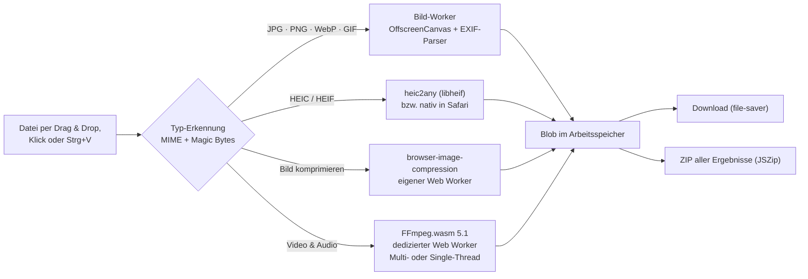

<div align="center">


# SnapMedia

**Videos & Bilder komprimieren, konvertieren, schneiden und von GPS-Daten befreien – 100 % lokal im Browser.**

Die kostenlose, private Alternative zu Convertio, Ezgif und CloudConvert.<br />
Kein Upload. Kein Konto. Kein Wasserzeichen. Keine Warteschlange.

[](LICENSE)
[](https://nextjs.org)
[](https://www.typescriptlang.org)
[](https://github.com/ffmpegwasm/ffmpeg.wasm)
[](#-datenschutz-im-vergleich)
[](https://ko-fi.com/cind3rbyte)

[Features](#-features) · [Datenschutz](#-datenschutz-im-vergleich) · [Schnellstart](#-schnellstart) · [Vercel-Deployment](#-deployment-auf-vercel) · [So funktioniert's](#-so-funktioniert-es) · [Unterstützen](#-unterstützen)

<br />


</div>

> **🔒 100 % Lokal & Privat: Deine Dateien verlassen niemals dein Gerät.**
> FFmpeg, libheif und die Bildverarbeitung laufen als WebAssembly in Web Workern direkt in deinem Browser.
> Eine Content-Security-Policy (`connect-src 'self'`) verbietet der App technisch jede Verbindung zu fremden Servern –
> selbst wenn eine Bibliothek es versuchen würde, blockiert der Browser die Anfrage.

---

## ✨ Features

Zieh beliebige Medien auf die Dropzone – SnapMedia erkennt den Dateityp (MIME-Type **und** Magic Bytes, damit auch HEIC, MKV & Co. ohne korrekten MIME-Type erkannt werden) und zeigt nur die passenden Werkzeuge.

| Werkzeug | Was es kann | Formate |
| --- | --- | --- |
| 🗜️ **Chat- & Discord-Komprimierer** | Presets **„Unter 10 MB (Discord Free)“**, **„Unter 5 MB (E-Mail / Upload-Limits)“** und **„Maximale Web-Kompression“**. Bitrate, Auflösung und Bildrate werden aus der Videolänge berechnet; die fertige Datei wird geprüft und bei Bedarf automatisch nachjustiert. Animierte GIFs bleiben animiert. | Video: MP4, MOV, WebM, MKV, AVI → MP4 (H.264/AAC) · Bild: JPG, PNG, WebP, HEIC, AVIF, GIF · Audio: MP3, WAV, FLAC, M4A, OGG → AAC |
| 🔄 **Format-Konverter** | Bilder sofort in sauberes JPG, PNG oder WebP (ohne Metadaten), SVG in 1×/2×/4×, Transparenz mit wählbarer Hintergrundfarbe. Tonspur aus Videos als MP3 (128–320 kbit/s) oder **verlustfrei als AAC** (die Originalspur wird 1:1 übernommen, wenn sie bereits AAC ist). Dazu: MOV/MKV → MP4, Video → GIF, GIF → MP4. | HEIC, HEIF, WebP, SVG, PNG, JPG, AVIF, BMP, TIFF, GIF · MP4, MOV, MKV, WebM, AVI, MP3, WAV, FLAC, OGG |
| ✂️ **Video-Cutter & Trimmer** | Visuelle Timeline mit Vorschaubildern (bzw. Wellenform bei Audio), zwei ziehbaren Griffen, verschiebbarer Auswahl, Tastatursteuerung (←/→ = 0,1 s, Shift = 1 s) und Zeiteingabe auf die Zehntelsekunde. Export **verlustfrei in Sekunden** (MP4/MOV starten dank Edit-List exakt am gewählten Punkt) oder **framegenau** neu kodiert. | MP4, MOV, MKV, WebM, AVI, HEVC/H.265, MP3, M4A, WAV, FLAC, OGG |
| 🛡️ **Privacy-Cleaner (EXIF-Strip)** | Entfernt GPS-Koordinaten, Kamera- & Handymodell, Seriennummern, Objektiv, Aufnahmezeit, Software, Urheber, XMP/IPTC und Kommentare. Zeigt vorher, was gefunden wurde, und prüft das Ergebnis. JPG, PNG, WebP und GIF werden **verlustfrei** bereinigt (bit-identische Pixel, Ausrichtung und Farbprofil bleiben erhalten). Videos (z. B. iPhone-Standort) & Audio ohne Neukodierung. | JPG, PNG, WebP, GIF, HEIC, AVIF, TIFF · MP4, MOV, MKV, WebM, MP3, M4A … |

**Außerdem:** Drag & Drop überall auf der Seite und Einfügen per <kbd>Strg</kbd>+<kbd>V</kbd>, Stapelverarbeitung, reaktive Fortschrittsbalken mit Prozentanzeige, Abbrechen laufender Jobs, Vorschau der Ergebnisse, **Bulk-Download als ZIP**, Dark-/Light-Mode und ein Layout, das auch auf dem Smartphone funktioniert.

<table>
  <tr>
    <td></td>
    <td></td>
  </tr>
  <tr>
    <td align="center"><sub>42-MB-Video (1080p, 45 s) → 9,6 MB für Discord</sub></td>
    <td align="center"><sub>Privacy-Cleaner: 11 Einträge entfernt, Pixel unverändert</sub></td>
  </tr>
</table>

<div align="center">
  
  <br /><sub>Video-Cutter mit Vorschaubild-Timeline (Dark Mode)</sub>
</div>

## 🔐 Datenschutz im Vergleich

Klassische Online-Konverter laden deine Dateien auf ihre Server. Bei privaten Fotos und Videos – mit Gesichtern, Kennzeichen und GPS-Koordinaten deines Zuhauses – ist das ein echtes Risiko.

| | **SnapMedia** | CloudConvert | Convertio |
| --- | :---: | :---: | :---: |
| Wo wird verarbeitet? | **In deinem Browser** (WebAssembly) | Auf deren Servern | Auf deren Servern |
| Dateien verlassen dein Gerät | **Nie** | Ja (Upload) | Ja (Upload) |
| Technisch erzwungen (CSP `connect-src 'self'`) | **Ja** | – | – |
| Konto / Abo für größere Mengen | **Nicht nötig** | Für mehr Kontingent | Für größere Dateien |
| Limits | **Nur dein Gerät** (RAM/CPU) | Tageskontingent im Gratis-Tarif | Datei- & Tageslimits im Gratis-Tarif |
| Warteschlange bei Last | **Keine** | Möglich | Möglich |
| Arbeitet ohne Internet weiter, sobald die Seite geladen ist | **Ja** | Nein | Nein |
| Quellcode überprüfbar | **Ja, MIT** | Nein | Nein |
| Kosten | **0 €** | Gratis-Kontingent, danach kostenpflichtig | Gratis mit Limits, danach Abo |

<sub>Angaben zu Drittanbietern: allgemeine Funktionsweise, Stand November 2026, ohne Gewähr – maßgeblich sind deren aktuelle Preis- und Datenschutzseiten.</sub>

**Selbst nachprüfen:** Öffne die Entwicklertools → Netzwerk-Tab und verarbeite eine Datei. Außer den eigenen Programmdateien von SnapMedia (z. B. der FFmpeg-Engine unter `/ffmpeg/`) gibt es keinen einzigen Request – erst recht keinen Upload.

## ⚡ Schnellstart

Voraussetzung: **Node.js ≥ 18.18** (empfohlen: 20 LTS oder neuer).

```bash
git clone https://github.com/Cind3rbyte/snapmedia.git
```

```bash
cd snapmedia
```

```bash
npm install
```

```bash
npm run dev
```

Danach [http://localhost:3000](http://localhost:3000) öffnen – fertig. 🎉

`npm install` kopiert per `postinstall` automatisch die WebAssembly-Engines aus `node_modules` nach `public/ffmpeg/` und `public/vendor/` (sie werden also selbst gehostet und nicht von einem CDN geladen).

Weitere Befehle:

| Befehl | Zweck |
| --- | --- |
| `npm run build` | Produktions-Build (inkl. Typprüfung & Lint) |
| `npm start` | Produktions-Server starten |
| `npm run lint` | ESLint (Next.js Core Web Vitals + TypeScript) |
| `npm run typecheck` | TypeScript-Prüfung im Strict-Mode |

## ▲ Deployment auf Vercel

SnapMedia ist ein Standard-Next.js-Projekt und braucht **null Konfiguration**:

[](https://vercel.com/new/clone?repository-url=https%3A%2F%2Fgithub.com%2FCind3rbyte%2Fsnapmedia&project-name=snapmedia&repository-name=snapmedia)

1. Repository auf [vercel.com/new](https://vercel.com/new) importieren (oder den Button oben nutzen).
2. Framework wird automatisch als **Next.js** erkannt → **Deploy**.

Die nötigen Header (`Cross-Origin-Opener-Policy: same-origin`, `Cross-Origin-Embedder-Policy: require-corp`, Content-Security-Policy u. a.) setzt `next.config.js` – auf Vercel genauso wie lokal. Dadurch steht `SharedArrayBuffer` zur Verfügung und FFmpeg läuft im schnellen **Multi-Thread-Modus**.

> **Andere Hoster** (Netlify, eigener Server, Docker …) funktionieren ebenfalls mit `npm run build && npm start`. Liefert ein Hoster die COOP/COEP-Header nicht aus, schaltet SnapMedia automatisch auf die Single-Thread-Engine um – langsamer, aber voll funktionsfähig.

## 🧠 So funktioniert es



### Discord-/E-Mail-Komprimierung: exakt unter dem Limit

1. **Analyse** per `ffprobe` (JSON): Dauer, Auflösung, Bildrate, Rotation, Codecs, Bitraten.
2. **Budget:** `Zielgröße × 0,95 − Container-Overhead` → Gesamtbitrate = Budget × 8 ÷ Dauer.
3. **Aufteilung:** Audio 128/96/64/32 kbit/s je nach Budget, der Rest geht an das Video.
4. **Auflösung & Bildrate** passend zur Video-Bitrate (1080p ≥ 4 Mbit/s, 720p ≥ 2 Mbit/s, 540p, 480p, 360p, 240p; max. 30 fps bei kleinen Budgets). Hochkant-Videos werden korrekt erkannt, nie wird hochskaliert.
5. **Kodierung** mit x264 (ABR + VBV) und `+faststart` für sofortiges Abspielen.
6. **Prüfung:** Liegt die Datei doch über dem Limit, wird die Video-Bitrate proportional gesenkt und neu kodiert (max. 3 Durchgänge). Dateien, die bereits passen, bleiben unverändert.

> Beispiel aus dem Test: 42-MB-Video (1080p, 45 s) → **9,6 MB** (540p, 1,58 Mbit/s + 96 kbit/s AAC) in ca. 45 Sekunden im Multi-Thread-Modus auf 4 CPU-Kernen.

### Privacy-Cleaner: verlustfrei statt neu kodiert

Statt Fotos neu zu speichern (Qualitätsverlust!), schneidet SnapMedia die Metadaten-Blöcke direkt aus der Datei:

- **JPEG:** entfernt APP1 (EXIF/XMP), APP13 (IPTC), Kommentare, Hersteller-Segmente und angehängte Zusatzbilder (MPF). Die **Ausrichtung** bleibt über einen minimalen EXIF-Block erhalten, das **ICC-Farbprofil** optional.
- **PNG:** entfernt `tEXt`, `zTXt`, `iTXt` (XMP), `eXIf`, `tIME`.
- **WebP:** entfernt `EXIF`/`XMP`-Chunks und korrigiert VP8X-Flags & RIFF-Größe.
- **GIF:** entfernt Kommentar- und XMP-Blöcke – die Animation bleibt erhalten.
- **HEIC/AVIF/TIFF** werden als sauberes JPG/PNG gespeichert; **Videos & Audio** per FFmpeg-Stream-Copy (`-map_metadata -1`) ohne Neukodierung, inklusive Apple-Standortdaten (`com.apple.quicktime.location.ISO6709`).

Danach wird die Datei erneut analysiert – erst dann zeigt SnapMedia „Geprüft: keine GPS-, Geräte- oder Personendaten mehr enthalten“.

### Engine-Details

- **FFmpeg.wasm** (`@ffmpeg/ffmpeg` + `@ffmpeg/core`/`@ffmpeg/core-mt` 0.12) läuft in einem dedizierten Web Worker. Mit Cross-Origin-Isolation wird der Multi-Thread-Core genutzt (Thread-Anzahl bewusst begrenzt, da der Core einen festen Pool von 32 pthreads hat), sonst automatisch der Single-Thread-Core.
- **Große Dateien** werden per `WORKERFS` eingebunden: FFmpeg liest direkt aus dem `File`-Objekt, statt das ganze Video in den Speicher zu kopieren.
- Die Engine (~32 MB) wird beim ersten Video einmalig mit Fortschrittsanzeige geladen und vom Browser gecacht. Abgebrochene oder abgestürzte Jobs starten die Engine transparent neu.
- **Bilder** laufen in einem eigenen Web Worker (`src/workers/image.worker.ts`) mit OffscreenCanvas; Kompression über `browser-image-compression` (ebenfalls im Worker, Bibliothek selbst gehostet unter `/vendor/`).

## 🗂️ Projektstruktur

```text
snapmedia/
├── next.config.js              # COOP/COEP (SharedArrayBuffer), CSP & Security-Header
├── scripts/
│   └── copy-wasm-assets.mjs    # kopiert FFmpeg-Cores & Worker-Bibliotheken nach public/
├── src/
│   ├── app/                    # App Router: Layout, Startseite, Icon, Manifest, Tailwind-Theme
│   ├── components/
│   │   ├── site-header.tsx     # Sticky Header mit Ko-fi- & GitHub-Link, Theme-Umschalter
│   │   ├── site-footer.tsx     # Footer mit Spendenaufruf & Lizenzhinweisen
│   │   ├── workspace/          # Dropzone, Dateiliste, Werkzeug-Tabs, Job-Queue, Ergebnisse & ZIP
│   │   ├── tools/              # Komprimieren, Konvertieren, Schneiden (Timeline), Privatsphäre
│   │   └── ui/                 # Button, Fortschrittsbalken, Segmented Control, Formularfelder
│   ├── lib/
│   │   ├── ffmpeg/             # Engine (MT/ST, Download, Queue, Abbruch), Probe, Tasks, I/O
│   │   ├── image/              # EXIF-Parser & -Stripper, Canvas, HEIC/SVG-Dekoder, Tasks
│   │   ├── file-types.ts       # MIME + Magic-Byte-Erkennung, Werkzeug-Zuordnung
│   │   ├── presets.ts          # Discord/E-Mail/Web-Presets & Bitraten-Berechnung
│   │   └── download.ts         # file-saver & JSZip
│   └── workers/
│       └── image.worker.ts     # Bild-Worker: Metadaten lesen/entfernen, konvertieren
└── docs/                       # Screenshots für diese README
```

## 🌐 Browser-Unterstützung

| Browser | Unterstützung |
| --- | --- |
| Chrome / Edge (Desktop & Android) | ✅ Multi-Thread-Engine |
| Firefox | ✅ Multi-Thread-Engine |
| Safari (macOS & iOS, aktuelle Versionen) | ✅ HEIC wird ab Safari 17 sogar nativ dekodiert; ohne Multi-Thread-Unterstützung greift automatisch die Single-Thread-Engine |

Automatisiert getestet wird mit Chromium (Playwright, Multi- und Single-Thread-Modus). Firefox und Safari nutzen dieselben Web-Standards (WebAssembly, Web Worker, `SharedArrayBuffer`, Canvas); für alles, was ein Browser nicht kann (z. B. OffscreenCanvas oder WebP-Export in älteren Safari-Versionen), gibt es eingebaute Fallbacks.

Hinweise: Sehr große Videos (mehrere GB oder 4K mit hoher Bildrate) können den Arbeitsspeicher des Browsers sprengen – dann hilft es, das Video zuerst mit dem Cutter zu kürzen. HEVC-Videos, die der Browser nicht abspielen kann, lassen sich trotzdem schneiden: Die Vorschaubilder erzeugt dann FFmpeg.

## ⚙️ Konfiguration

Optional per Umgebungsvariablen (z. B. in Vercel unter *Settings → Environment Variables* oder lokal in `.env.local`, siehe `.env.example`):

| Variable | Standard | Zweck |
| --- | --- | --- |
| `NEXT_PUBLIC_KOFI_URL` | `https://ko-fi.com/cind3rbyte` | Ziel des „☕ Buy Me a Coffee / Support on Ko-fi“-Buttons |
| `NEXT_PUBLIC_GITHUB_URL` | `https://github.com/Cind3rbyte/snapmedia` | GitHub-Link in Header & Footer |
| `NEXT_PUBLIC_SITE_URL` | `https://snapmedia.vercel.app` | Basis-URL für Open-Graph-Metadaten |

## 🛠️ Fehlersuche

- **Ausführliche FFmpeg-Logs:** In der Browser-Konsole `localStorage.snapmediaDebug = "1"` ausführen und die Seite neu laden. Alle FFmpeg-Ausgaben erscheinen dann als `[ffmpeg] …` in der Konsole.
- **„Single-Thread-Modus“ statt Multi-Thread:** Der Hoster liefert die COOP/COEP-Header nicht aus. Prüfen mit `curl -I https://deine-domain` – beide Header müssen in der Antwort stehen.
- **Engine lädt nicht:** `npm install` erneut ausführen; `public/ffmpeg/` muss `st/` und `mt/` enthalten.

## ☕ Unterstützen

SnapMedia ist kostenlos, werbefrei und wird es bleiben. Wenn dir das Tool Zeit, Upload-Ärger oder ein Abo bei einem Cloud-Konverter erspart hat, freue ich mich riesig über einen Kaffee:

<a href="https://ko-fi.com/cind3rbyte"></a>

Und kostenlos: ⭐ **Gib dem Repository einen Stern** – das hilft anderen, eine private Alternative zu finden. Bugs und Ideen gerne als [Issue](https://github.com/Cind3rbyte/snapmedia/issues).

## 📜 Lizenzen

Der Quellcode von SnapMedia steht unter der [MIT-Lizenz](LICENSE).

Mitgelieferte Drittanbieter-Komponenten behalten ihre eigenen Lizenzen:

| Komponente | Lizenz | Quellcode |
| --- | --- | --- |
| FFmpeg WebAssembly-Core (`@ffmpeg/core`, `@ffmpeg/core-mt`, enthält x264/x265) | GPL-2.0-or-later | [ffmpegwasm/ffmpeg.wasm](https://github.com/ffmpegwasm/ffmpeg.wasm), [FFmpeg](https://ffmpeg.org/download.html) |
| `@ffmpeg/ffmpeg`, `@ffmpeg/util` | MIT | [ffmpegwasm/ffmpeg.wasm](https://github.com/ffmpegwasm/ffmpeg.wasm) |
| `heic2any` (enthält libheif) | MIT (libheif: LGPL-3.0) | [alexcorvi/heic2any](https://github.com/alexcorvi/heic2any) |
| `browser-image-compression` | MIT | [Donaldcwl/browser-image-compression](https://github.com/Donaldcwl/browser-image-compression) |
| `jszip` | MIT oder GPL-3.0 | [Stuk/jszip](https://github.com/Stuk/jszip) |
| `file-saver` | MIT | [eligrey/FileSaver.js](https://github.com/eligrey/FileSaver.js) |
| `lucide-react` | ISC | [lucide-icons/lucide](https://github.com/lucide-icons/lucide) |
| Geist (Schrift) | SIL Open Font License 1.1 | [vercel/geist-font](https://github.com/vercel/geist-font) |

Die FFmpeg-Engine wird beim Build unverändert aus den npm-Paketen übernommen und an den Browser ausgeliefert; ihr vollständiger Quellcode ist unter den oben verlinkten Adressen verfügbar.
